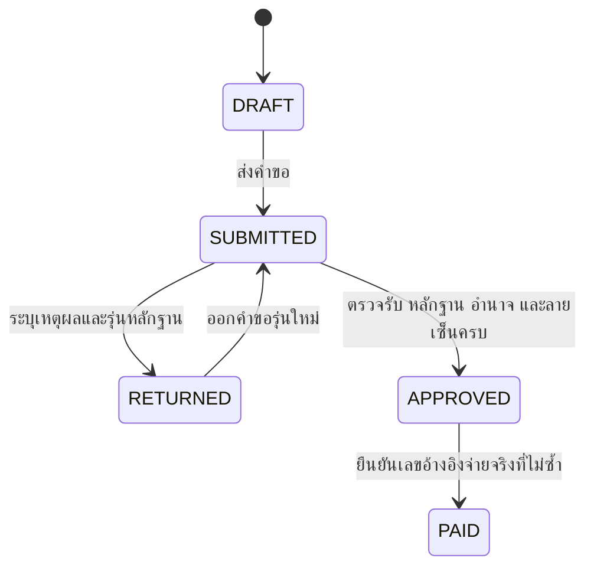

# รายงานระยะที่ 2 — ระบบบริหารจัดการห่วงโซ่คุณค่าพัสดุภาครัฐแบบครบวงจร

โรงพยาบาลอุดรธานี · พัฒนาโดย Pacific Plus IT · วันที่ 1 พฤศจิกายน 2569

**@Procurement_Architect: ผลส่งมอบและขอบเขต**

รายงานนี้เป็นแบบออกแบบทางเทคนิคพร้อมแกนโค้ดที่ทดสอบได้และหน้าต้นแบบข้อมูลจำลอง ครอบคลุมวงจร 15 ขั้นตอนตามที่ผู้ใช้กำหนด ยังไม่ใช่ระบบที่ได้รับรองสำหรับธุรกรรมจริงของโรงพยาบาล ไม่มีการเชื่อม HOSxP, Provider ID, e-GP, GFMIS หรือฐานข้อมูลโรงพยาบาล และไม่มีการจ่ายเงินจริง

สิ่งที่ยืนยันแล้วคือ ครอบคลุมจัดซื้อ จัดจ้าง จ้างเหมาบริการ จ้างซ่อมบำรุง เช่า ก่อสร้าง และทรัพย์สินรับบริจาค ใช้เงินงบประมาณประจำปี เงินบำรุง และเงินบริจาค รองรับวิธีเฉพาะเจาะจง e-market และ e-bidding โดยอ้างอิงกฎหมายที่เหมาะกับกรณี ผูกพันงบเมื่อทำสัญญา แยกจากการจ่ายเงินจริง ค่าเสื่อมอ้างอิงหลักเกณฑ์ภาครัฐ เอกสารที่ต้องลงนามคงต้นฉบับหมึกจริง และปัจจุบันทำงานสองระบบคู่กัน

ข้อที่ยังไม่ยืนยัน ได้แก่ ชื่อระบบเดิมและเจ้าของข้อมูลทางการ รายชื่อและอำนาจผู้อนุมัติ ตารางค่าเสื่อมและวันเริ่มคิดของโรงพยาบาล การใช้เงินหลายแหล่งร่วมกันหรือข้ามปี รายละเอียดตรวจนับ/จำหน่าย และนโยบายออฟไลน์ คำตอบว่า “เมื่อหมดค่าเสื่อม” ยังไม่ถือเป็นการอนุมัติให้จำหน่ายอัตโนมัติ คำตอบว่า “ทั้งหมด” ในข้อเอกสารยืนยันเรื่องเก็บต้นฉบับ แต่ยังไม่ชัดว่าทุกขั้นตอนติดขัดหรือไม่

**@Procurement_Architect: วงจร 15 ขั้นตอนและหลักฐาน**

| ขั้น | งาน | ผู้รับผิดชอบหลักที่ต้องยืนยันตามคำสั่ง | หลักฐานหรือเงื่อนไข |
|---|---|---|---|
| 1 | หน่วยงานย่อยทำคำขอ | ผู้ใช้งาน/หัวหน้าหน่วย | เหตุผลความจำเป็น ข้อมูลของเดิมและความต้องการ |
| 2 | แผนประจำปี | ฝ่ายแผน | แผนที่มีรุ่นและที่มาของคำขอ |
| 3 | อนุมัติงบ | ผู้มีอำนาจ | แหล่งเงิน ปีงบ วงเงินและคำอนุมัติ |
| 4 | ขอจัดซื้อหรือจัดจ้าง PR | พัสดุ/หน่วยงานผู้ขอ | คำขอและขอบเขตความต้องการ |
| 5 | ตรวจยอดงบก่อนผูกพัน | แผน/การเงิน | ยืนยันงบเพียงพอ; ยังไม่ถือว่าผูกพันหรือจ่ายเงิน |
| 6 | สืบราคา ราคากลาง TOR | ผู้ได้รับแต่งตั้ง | แหล่งราคา เกณฑ์คุณลักษณะ และรุ่น TOR |
| 7 | ดำเนินวิธีจัดหา | พัสดุ/คณะกรรมการ | เหตุผลเลือกวิธี ประกาศ ผลพิจารณา และเลข e-GP เมื่อเกี่ยวข้อง |
| 8 | ทำสัญญาหรือ PO | ผู้มีอำนาจ/คู่สัญญา | เอกสารลงหมึกที่ตรวจแล้ว และผูกพันงบในธุรกรรมเดียวกัน |
| 9 | ตรวจรับ | คณะกรรมการ/ผู้ตรวจรับตามกรณี | ส่งมอบรายงวด รายการที่ยอมรับจริง มติและเอกสารลงนาม |
| 10 | เบิกจ่ายจริง | การเงิน/ผู้อนุมัติ | ใบแจ้งหนี้ หลักฐานตรวจรับ เลขอ้างอิงจ่ายจริงและรายการภาษีที่เกี่ยวข้อง |
| 11 | ลงทะเบียนครุภัณฑ์/ทรัพยากร | บัญชี/พัสดุ | แหล่งที่มา ราคาทุน วันที่พร้อมใช้ และนโยบายบัญชี |
| 12 | จ่ายให้หน่วยงาน | คลัง/ผู้รับมอบ | ผู้ส่ง ผู้รับ หน่วยงาน และหลักฐานส่งมอบ |
| 13 | แจ้งซ่อม | ผู้ใช้/ช่าง/พัสดุ | อาการเสีย งานซ่อม ผลทดสอบและผู้ปล่อยกลับใช้งาน |
| 14 | ค่าเสื่อม | บัญชี | นโยบายที่อนุมัติ งวดบัญชี และรายการที่กระทบยอดได้ |
| 15 | ตรวจประจำปีและจำหน่าย | ผู้ตรวจ/ผู้มีอำนาจ/พัสดุ/บัญชี | ตรวจตัวจริง เหตุผลจำหน่าย คำอนุมัติ หลักฐานขาย/โอน/ทำลายและตัดทะเบียน |

ขั้นที่ 5 ปรับความหมายจากคำว่า “ตัดยอดงบ” ให้สอดคล้องคำตอบที่ยืนยันว่าผูกพันตอนทำสัญญา ส่วนการจองงบก่อนสัญญายังเป็นเรื่องรอยืนยัน จึงไม่สร้างยอดจองซ้ำขึ้นเอง ลำดับหน้าจอไม่ใช่ข้อบังคับว่าทุกงานต้องรอจ่ายเงินจึงรับรู้สินทรัพย์ วันที่บัญชีต้องเป็นไปตามนโยบายและเหตุการณ์จริง

**@DB_Compliance_Lead: แต่ละประเภทงานไม่สร้างครุภัณฑ์เหมือนกัน**

| ประเภท | สิ่งที่ควบคุมและรับมอบ | ขอบเขตบัญชีที่ต้องแยก |
|---|---|---|
| ซื้อ | รายชิ้น ชุด เลขเครื่อง หรือล็อตวัสดุ | วัสดุ/ค่าใช้จ่าย/สินทรัพย์ตามเกณฑ์ที่อนุมัติ |
| จัดจ้างและเหมาบริการ | ผลงาน งวดบริการ ปริมาณและคุณภาพ | ไม่สร้างทรัพย์สินถาวรให้ทุกใบจ้างโดยอัตโนมัติ |
| ซ่อมบำรุง | งานซ่อมเชื่อมเครื่องเดิม ผลทดสอบ | แยกค่าซ่อมปกติกับรายจ่ายปรับปรุงที่เข้าเกณฑ์ทุน |
| เช่า | สัญญา เครื่องที่ครอบครอง สิทธิใช้งานและวันคืน | ไม่ถือว่าโรงพยาบาลเป็นเจ้าของหรือคิดค่าเสื่อมแบบซื้อทุกกรณี |
| ก่อสร้าง | งวดงาน ปริมาณ ผลตรวจและหลักประกัน | แยกงานระหว่างก่อสร้างและวันที่พร้อมใช้งาน; พิจารณาฉบับแก้ไขปี 2569 |
| รับบริจาคทรัพย์สิน | การรับบริจาค เงื่อนไขผู้ให้ มูลค่าที่รับรอง | ไม่สร้าง PO หรือการจ่ายเงินสมมติ |

เงินบริจาคเพื่อซื้อของกับการรับทรัพย์สินบริจาคโดยตรงเป็นคนละเหตุการณ์ กรณีเงินบริจาคล้วนของสถานพยาบาลรัฐต้องตรวจเงื่อนไขมาตรา 7(6) และระเบียบเฉพาะ การมีแหล่งเงินชื่อบริจาคไม่ทำให้ได้รับยกเว้นทุกกรณี และห้ามนำข้อยกเว้นนั้นไปใช้กับการผสมเงินงบประมาณโดยอัตโนมัติ [มาตรา 7](https://cpb.ddc.moph.go.th/ddc-pic/law/act-2560/7), [ระเบียบเงินบริจาคของหน่วยบริการ](https://audit.anamai.moph.go.th/th/consulting-services/download?did=17301&id=57647&lang=th&mid=30413&mkey=m_document)

วิธีเฉพาะเจาะจงเป็นวิธีจัดหา ส่วน e-market/e-bidding อยู่ภายใต้วิธีประกาศเชิญชวนทั่วไป วิธีคัดเลือกและวิธีเฉพาะงานอื่นเก็บเป็นทางเลือกที่ต้องมีฐานกฎหมายและการยืนยันขอบเขตเพิ่มเติม ไม่เปิดให้เลือกเพื่อหลีกเลี่ยงเงื่อนไข [คำอธิบายวิธีจัดหาจากกรมควบคุมโรค](https://cpb.ddc.moph.go.th/ddc-pic/guide)

**งานที่ 1 — @UX_Frontend_Pro และ @RedTeam_Hacker: รับข้อมูลหลายช่องทาง**

| ช่องทาง | ขั้นตอนรับเข้า | ด่านป้องกันข้อมูลผิด |
|---|---|---|
| OCR | ภาพใบส่งของ/ใบแจ้งหนี้/ป้ายเครื่อง → ข้อมูลเสนอ → เจ้าหน้าที่เทียบต้นฉบับ | ตรวจ serial ราคา ภาษี และเลขสัญญารายช่อง ไม่อนุมัติจากค่าความมั่นใจอย่างเดียว |
| Excel/CSV | แม่แบบมีรุ่น → staging → ตรวจรายแถว → ตัวอย่างผล → ยืนยัน | จำกัดไฟล์/แถว/การแตก zip, ไม่รัน macro/formula, ตรวจซ้ำ/หน่วยนับ/ราคา/แหล่งเงิน |
| Barcode/QR | ตรวจรูปแบบ → ค้นทะเบียนในสิทธิ์ → เลือกงาน → ยืนยัน | รหัสไม่มีข้อมูลผู้ป่วย ไม่ fetch URL ใน QR ไม่ต่อ SQL |
| RFID | อ่านหลายแท็ก → กรองซ้ำ → รายการไม่รู้จัก → ผู้ตรวจรับรอง | การพบแท็กไม่เท่ากับยืนยันกรรมสิทธิ์หรือผู้ครอบครอง |
| BLE | AP/Gateway ส่ง observation → สรุปพื้นที่พร้อมเวลาและความเชื่อมั่น | ไม่ใช้ RSSI แทนหลักฐานตรวจรับ/โอน/จำหน่าย |

การใช้งานปกติของพยาบาลที่มี session แล้ว: แตะสแกน → เครื่องอ่านรับรหัส/เติมข้อมูล → แตะยืนยัน รวมสองการแตะในกรณีไม่มีข้อผิดพลาด ข้อมูลรุ่นและเลขเครื่องมาจากทะเบียนครุภัณฑ์ ส่วน HOSxP ใช้เติมเฉพาะข้อมูลอ้างอิงหน่วยงาน/บุคลากรที่ API และสิทธิ์จริงอนุญาต แสดงแหล่งข้อมูล เวลาปรับปรุง และความเก่าของสำเนา หากไม่มีสิทธิ์เชื่อมต่อให้หยุดที่ข้อมูลทะเบียน ไม่สร้าง endpoint HOSxP สมมติ

โค้ดที่มีจริงอยู่ใน `backend/src/policy.ts` ใช้ Zod ตรวจป้ายตัวอย่าง `UTH-YY-NNNNN` ปฏิเสธ URL ข้อความ SQL และ control character กลางรหัส ตัดเฉพาะ CR/LF ท้ายรหัส หน้าต้นแบบรองรับ CSV และเครื่องสแกนแบบแป้นพิมพ์ การเปิดกล้อง OCR, Excel .xlsx, RFID และ BLE จริงยังไม่ได้เชื่อมต่อ

```ts
import { z } from "zod";

export const barcodeSchema = z.string().max(80)
  .transform(value => value.replace(/[\r\n]+$/, ""))
  .pipe(z.string().regex(/^UTH-\d{2}-\d{5}$/i))
  .transform(value => value.toUpperCase());

// ตรวจสิทธิ์อีกครั้งที่เซิร์ฟเวอร์ และใช้ Prisma/SQL แบบผูกพารามิเตอร์
// รูปแบบป้ายเป็นตัวอย่าง ต้องแมปทะเบียนเดิมก่อนใช้กับครุภัณฑ์จริง
```

**งานที่ 2 — @DB_Compliance_Lead: สคีมาและบัญชีงบประมาณ**

ไฟล์ `prisma/phase2.prisma` เป็นแบบขยายแยกจากสคีมาที่ API เดิมใช้อยู่ ผ่าน Prisma validate และสร้าง SQL เริ่มต้นแบบไม่ต่อฐานข้อมูลแล้ว ยังไม่ apply migration และยังไม่ย้าย API เดิมไปใช้แบบใหม่

| กลุ่ม | โมเดลหลัก | สิ่งที่เชื่อมโยง |
|---|---|---|
| แผนและเงิน | DemandRequest, AnnualPlan, Fund, BudgetEnvelope | ความต้องการ แผน ปีงบ แหล่งเงิน และหน่วยงาน |
| จัดหา | ProcurementCase, Contract, Commitment | PR/TOR/ฐานกฎหมาย/เลข e-GP สัญญา และงบที่ผูกพัน |
| รับมอบและจ่าย | Delivery, ClaimDelivery, PaymentClaim, PaymentPosting | รับบางส่วน หลายงวด เอกสารรุ่นใหม่ และเลขอ้างอิงจ่ายไม่ซ้ำ |
| ทะเบียน | ManagedResource, DonationReceipt, CustodyEvent, MaintenanceOrder | ที่มาจากซื้อ/บริจาค ประเภททรัพยากร ผู้ครอบครองและซ่อม |
| บัญชี | DepreciationPolicy, DepreciationPosting, Journal, JournalLine | นโยบายมีรุ่น ค่าเสื่อมรายงวด เดบิต/เครดิตและกลับรายการ |
| สิ้นอายุ | InventoryObservation, DisposalCase | ผลตรวจจริง เหตุผลอนุมัติ และหลักฐานจำหน่าย |
| อำนาจและหลักฐาน | RoleGrant, CommitteeMandate, DeviceEnrollment, DocumentRevision | คำสั่งแต่งตั้ง สิทธิ์ อุปกรณ์และต้นฉบับหมึก |
| ตรวจสอบ/เชื่อมต่อ | AuditStream, AuditEvent, CommandReceipt, SyncConflict, OutboxEvent, ExternalMapping | ประวัติต่อท้าย คำสั่งซ้ำ ข้อขัดแย้ง และกระทบยอดสองระบบ |

ความสัมพันธ์หลักใช้ hospitalId ร่วมกับ id ใน foreign key เพื่อป้องกันอ้างข้ามโรงพยาบาล รหัสอ้างเอกสารที่ยังเป็น scalar ต้องเพิ่มการตรวจว่าเอกสารอยู่โรงพยาบาล/เรื่อง/รุ่นเดียวกันก่อนรับรอง การมี foreign key อย่างเดียวไม่พิสูจน์อำนาจหรือความถูกต้องเอกสาร

ค่าการเงินใช้ BigInt หน่วยสตางค์ที่ฐานข้อมูล ห้ามส่ง BigInt ตรง JSON; ใช้ decimal string พร้อมตรวจขอบเขต ในตัวจำลองรับ safe integer แล้วคำนวณผ่าน BigInt ภายใน ส่วน quantity/หน่วยนับและรายละเอียดรายการย่อยต้องขยายตามแบบวัสดุและสัญญาจริงก่อนนำเข้า production

**@DB_Compliance_Lead: ผูกพันและจ่ายเงินจริงโดยไม่หักซ้ำ**

กำหนด `committedSatang` ใน BudgetEnvelope เป็นภาระผูกพันคงเหลือ ส่วน Commitment เก็บยอดตั้งต้น จ่ายสะสม และยอดปลดผูกพันแยกกัน:

`งบพร้อมผูกพันใหม่ = วงเงินจัดสรร − ภาระผูกพันคงเหลือ − จ่ายสะสม`

| เหตุการณ์ | จัดสรร | ผูกพันคงเหลือ | จ่ายสะสม | พร้อมผูกพันใหม่ |
|---|---:|---:|---:|---:|
| ก่อนทำสัญญา | 1,000,000 | 0 | 0 | 1,000,000 |
| ลงนามสัญญา | 1,000,000 | 1,000,000 | 0 | 0 |
| จ่ายงวดแรก | 1,000,000 | 700,000 | 300,000 | 0 |
| ยกเลิกส่วนที่เหลือโดยชอบ | 1,000,000 | 0 | 300,000 | 700,000 |

เมื่อจ่าย ไม่ลดวงเงินจัดสรรอีกครั้ง การคืนภาระผูกพันไม่ทำให้การจ่ายเดิมหายไป กรณีเพิ่มวงเงิน แก้สัญญา ใช้หลายแหล่งเงิน หรือข้ามปีต้องมีคำอนุมัติและนโยบายแยก ไม่รับเข้าโดยเดาความหมาย

โค้ดที่รันได้ใน `lib/lifecycle.mjs` ป้องกันยอดเกินงบ ตรวจ expectedVersion และป้องกัน paymentRef ซ้ำแม้เปลี่ยน opId ตัว reducer สาธิตยังไม่ใช่ฐานข้อมูลที่รองรับหลาย worker; production ต้องล็อกงบและสัญญาในลำดับคงที่ ตรวจ current version, unique paymentRef ระดับโรงพยาบาล และบันทึกผล/audit/outbox ในธุรกรรมเดียวกัน

```ts
// ตัวอย่างขอบเขตธุรกรรมสำหรับบริการ Prisma ระยะที่ 2 ยังไม่ใช่ endpoint ที่เปิดใช้
await prisma.$transaction(async tx => {
  const rows = await tx.$queryRaw`
    SELECT id, version, allocatedSatang, committedSatang, paidSatang
    FROM BudgetEnvelope
    WHERE hospitalId = ${actor.hospitalId} AND id = ${budgetId}
    FOR UPDATE
  `;
  // ตรวจสิทธิ์ปัจจุบัน คำสั่งซ้ำ รุ่นงบ ยอดคงเหลือ และเอกสารในธุรกรรมนี้
  // เพิ่ม Commitment/BudgetMovement และปรับยอดพร้อมกัน
  // เพิ่ม CommandReceipt + AuditEvent + OutboxEvent ก่อน commit
  // หาก unique key หรือเงื่อนไขล้มเหลว ให้ rollback ทุกส่วน
}, { isolationLevel: "Serializable" });
```

`prisma/phase2-guards.sql` เสริม CHECK ของงบ ยอดจ่าย ราคาทุน และรายการสมุดรายวัน พร้อม trigger ปฏิเสธแก้/ลบ audit, budget ledger, payment และ receipt บัญชี runtime ต้องไม่มี ALTER/DROP/TRIGGER และไม่มีสิทธิ์แก้/ลบตารางหลักฐาน การสมดุลทั้ง Journal ต้องตรวจเมื่อผ่านรายการภายใน transaction เพราะ CHECK รายแถวตรวจยอดรวมทั้งสมุดไม่ได้

**@Procurement_Architect: สถานะข้ามฝ่ายและทางออกเมื่อเรื่องติดค้าง**

แยกสถานะแผน จัดหา สัญญา ตรวจรับ คำขอจ่าย สมุดรายวัน และการใช้ทรัพย์สิน ไม่ใช้สถานะก้อนเดียวกับทั้งเรื่อง

กรณี PO ปิดแต่การเงินส่งคืน: คงสถานะสัญญาและผลตรวจรับ → PaymentClaim เป็น RETURNED พร้อมเหตุผล → เปิดงานแก้ไขที่มีเจ้าของ → จัดทำ revision ใหม่เชื่อมต้นฉบับ → ส่งตรวจใหม่ การเปลี่ยนสาระสัญญาต้องผ่านอำนาจแก้สัญญาต่างหาก ไม่มีคำสั่ง “เปิด PO กลับ” เพื่อหลบกฎบัญชี งานค้างมีเจ้าของและกำหนดติดตาม แต่ระบบไม่อนุมัติเองเพราะครบกำหนด



**@DB_Compliance_Lead: ค่าเสื่อมและสมุดรายวัน**

อ้างอิงมาตรฐานบัญชีภาครัฐและคู่มือกรมบัญชีกลาง ว 43 แต่ยังไม่กำหนดอายุ มูลค่าคงเหลือ เกณฑ์รับรู้ วันเริ่มหรือวิธีปันส่วนแทนโรงพยาบาล นโยบายแต่ละรุ่นต้องมีผู้อนุมัติและวันที่มีผล เก็บ snapshot กับรายการค่าเสื่อมเพื่อคำนวณย้อนหลังได้ [เอกสารเผยแพร่คู่มือ ว 43 ของกระทรวงพาณิชย์](https://finance.ops.moc.go.th/th/content/category/detail/id/416/cid/440/iid/8494)

ฟังก์ชันสาธิตใช้วิธีเส้นตรงรายเดือนตามพารามิเตอร์ที่ส่งเข้า คำนวณสะสมจากฐานเดียว เก็บเศษครบเมื่อถึงเดือนสุดท้าย และไม่ต่ำกว่ามูลค่าคงเหลือ การเลือก 60 เดือนในหน้าตัวอย่างเป็นสมมติฐานทดสอบที่แสดงชัด ยังไม่ใช่นโยบายที่โรงพยาบาลอนุมัติ ไม่ใช้ฟังก์ชันนี้ตัดสินสิทธิจำหน่าย

สินทรัพย์คิดค่าเสื่อมครบยังต้องอยู่ในทะเบียนและตรวจนับถ้ายังถือครอง การเสนอจำหน่ายต้องมีเหตุผล สภาพจริง อำนาจ และหลักฐานดำเนินการ ไม่ผูกเงื่อนไขว่าต้องค่าเสื่อมครบเท่านั้น [ระเบียบฯ ข้อ 213](https://cpb.ddc.moph.go.th/ddc-pic/law/reg-2560/213), [ข้อ 215](https://cpb.ddc.moph.go.th/ddc-pic/law/reg-2560/215)

**งานที่ 3 — @Procurement_Architect และ @DB_Compliance_Lead: สิทธิ์และออฟไลน์**

ใช้บทบาท + โรงพยาบาล + หน่วยงาน + เรื่องที่ได้รับแต่งตั้ง + วงเงิน + ช่วงเวลาที่มีอำนาจ ตรวจจากทะเบียนปัจจุบันทุกคำสั่ง ไม่ให้ browser ส่ง role/Provider ID/ผลตรวจหลักฐานมาเป็นอำนาจจริง Provider ID ใช้พิสูจน์ตัวบุคคลโดยแมป `(issuer, subject)` เข้าบัญชีภายใน แล้วตรวจ token audience, issuer, algorithm, expiry และระดับ/ความใหม่ของ 2FA ตามข้อมูลที่ผู้ให้บริการรองรับ

| ผู้เกี่ยวข้อง | หน้าที่ | เงื่อนไขเพิ่มเติม |
|---|---|---|
| แผน | รวมความต้องการและจัดทำแผน | ตามหน่วยงาน แหล่งเงิน และปีงบ |
| พัสดุ | PR วิธีจัดหา สัญญา เอกสารและทะเบียน | ตามคำสั่งมอบอำนาจและขอบเขตเรื่อง |
| การเงิน | ตรวจคำขอและยืนยันจ่ายจริง | แยกผู้จัดทำ/อนุมัติ และเลขอ้างอิงจ่ายไม่ซ้ำ |
| บัญชี | รับรู้สินทรัพย์ ค่าเสื่อม ปิดงวดและกลับรายการ | ไม่แก้รายการที่ผ่านบัญชีโดยไร้หลักฐาน |
| ผู้ใช้ | แจ้งความต้องการ รับมอบ แจ้งเสีย | เฉพาะหน่วยงานและทรัพย์สินในสิทธิ์ |
| คณะกรรมการ | TOR พิจารณาผล ตรวจรับ ตรวจนับตามที่แต่งตั้ง | ตรวจข้อห้ามบทบาทซ้ำ ผลประโยชน์ทับซ้อน องค์ประชุมและมติ |

ข้อ 26 มีข้อห้ามการเป็นกรรมการพิจารณาผล e-bidding/สอบราคา/วิธีคัดเลือกร่วมกับตรวจรับในการซื้อจ้างครั้งเดียวกัน ไม่ใช่ข้อห้ามเหมารวมทุกบทบาท ข้อ 27 กำหนดองค์ประชุมและมติ รวมทั้งมติเอกฉันท์ของคณะกรรมการตรวจรับ ต้องอ่านประกอบฉบับแก้ไข เช่น การประชุมอิเล็กทรอนิกส์ และคำสั่งเฉพาะ [ข้อ 26](https://cpb.ddc.moph.go.th/ddc-pic/law/reg-2560/26), [ข้อ 27](https://cpb.ddc.moph.go.th/ddc-pic/law/reg-2560/27), [ฉบับที่ 2 พ.ศ.2564](https://cpb.ddc.moph.go.th/ddc-pic/doc/94)

**@RedTeam_Hacker: นโยบายออฟไลน์ยังไม่อนุมัติ จึงไม่เปิดธุรกรรมจริงโดยปริยาย**

ในระยะนี้ `/api/sync` ที่ผ่าน auth/role/schema แล้วตอบ 503 `OFFLINE_POLICY_UNAPPROVED` ก่อนเข้าฐานข้อมูล ไม่มี environment flag ให้ข้ามนโยบาย หน้าต้นแบบเดิมยังจำลองคิวและ conflict ในเครื่องได้เพราะไม่ใช่ธุรกรรมจริง

ตัวช่วย `authorizeOfflineCommand` แสดงแนวทางเมื่อมีนโยบายอนุมัติในอนาคต: ต้องส่งนโยบายจากเซิร์ฟเวอร์ที่มีเลขอนุมัติ อายุสิทธิ์ และรายการงานที่อนุญาต ตรวจทะเบียนผู้ใช้/อุปกรณ์ปัจจุบัน ตรวจโรงพยาบาลและวอร์ด ใช้เวลารับของเซิร์ฟเวอร์เทียบเวลาสิทธิ์ที่ออก ไม่ใช้เวลาที่แท็บเล็ตอ้าง และอนุญาตเพียง draft observation ตามรายการที่ระบุ ห้ามอนุมัติจ่ายหรือจำหน่ายออฟไลน์

เมื่อได้รับอนุมัตินโยบายและเปิดบริการจริง การซิงก์ต้องทำตามลำดับ:

1. ตรวจตัวตน อุปกรณ์ สิทธิ์ปัจจุบันและอายุสิทธิ์ออฟไลน์
2. ล็อก resource ตาม hospital/resource ตรวจ receipt เดิมว่าผู้ส่งและ payload ตรง
3. เปรียบเทียบ baseVersion กับรุ่นส่วนกลาง
4. หากตรง ตรวจ transition แล้วแก้ทะเบียนพร้อมเพิ่มรุ่น
5. หากไม่ตรง เก็บ snapshot ปัจจุบันและคำสั่งเสนอใน SyncConflict ไม่ใช้เวลามาเลือกผู้ชนะ
6. เขียน receipt + audit + outbox ในธุรกรรมเดียวกัน ผล conflict ต้อง commit หลักฐานก่อนตอบ 409
7. ผู้มีอำนาจตรวจของจริงแล้วออกคำสั่งแก้ไขใหม่อ้างรุ่นปัจจุบันและเลข conflict

ห้ามรวมยอดเงิน สถานะผู้ครอบครอง หรือการจำหน่ายด้วยกฎ last-write-wins ข้ามเครื่อง การส่งซ้ำผลเดิมต้องไม่เพิ่มรุ่นหรือทำให้จ่ายอีกครั้ง

**งานที่ 4 — @UX_Frontend_Pro: หน้าจอและตัวชี้วัด**

เมนูไม่เกินสองระดับ: ภาพรวม → ผู้บริหาร/งานของฉัน; แผนและจัดหา → คำขอ/แผน/PR/สัญญา; ทรัพยากร → ทะเบียน/รับมอบ/ซ่อม; การเงินบัญชี → เบิกจ่าย/ค่าเสื่อม; ตรวจสอบ → ตรวจนับ/จำหน่าย/หลักฐาน รายละเอียดเปิดในแผงและแท็บ ไม่ซ้อนเมนูระดับสาม

ตัวชี้วัดผู้บริหารสี่ตัวที่ต่อยอดจากต้นแบบ:

| ตัวชี้วัด | นิยามและข้อจำกัด |
|---|---|
| งบพร้อมผูกพันใหม่ | จัดสรร − ภาระผูกพันคงเหลือ − จ่ายสะสม; แยกแหล่งเงิน/ปีงบ ไม่รวมเงินต่างเงื่อนไขโดยไร้คำอธิบาย |
| มูลค่าตามบัญชีสุทธิ | ราคาทุน − ค่าเสื่อมสะสม − การด้อยค่าที่บันทึก; อ้างวันตัดยอด |
| ความพร้อมใช้อุปกรณ์สำคัญ | จำนวนพร้อมให้บริการรวมที่กำลังใช้งาน ÷ จำนวนในขอบเขต; ไม่ตีความว่าเป็นเครื่องว่างพร้อมยืม |
| งานค้างข้ามฝ่าย | งานเกิน SLA ตามขั้นตอนพร้อมสาเหตุและเจ้าของ; SLA ต้องยืนยันกับโรงพยาบาล |

หน้าต้นแบบมี KPI เดิมสี่ตัวและ Heatmap วอร์ด×ประเภทอุปกรณ์ พร้อมจำนวนตัวหาร ส่วนตัวชี้วัดงบอยู่ในพื้นที่วงจร 15 ขั้นตอน ยังไม่ดึงยอดจริงมารวมเป็น dashboard กลาง กราฟแนวโน้มเป็นข้อมูลตัวอย่างที่ระบุไว้ชัด

ไฟล์ React ที่เพิ่มคือ `components/lifecycle-workspace.tsx` แสดง 5 ช่วง/15 ขั้น ตัวกรองประเภทงานและเงิน ตัวจำลองผูกพัน/ทยอยจ่าย ตรวจรับและลายเซ็นก่อนจ่าย และตัวอย่างค่าเสื่อมที่ไม่จำหน่ายอัตโนมัติ ตัวกรองงานยังเป็นบริบทสาธิต ไม่สรุปวิธีจัดหาหรือกฎบัญชีจริงให้เอง

**งานที่ 5 — @RedTeam_Hacker: วิเคราะห์ก่อนเกิดเหตุ**

| เหตุการณ์เสี่ยง | วิธีป้องกัน/หลักฐานที่ต้องพิสูจน์ |
|---|---|
| จ่ายซ้ำด้วย opId ใหม่ | unique เลขอ้างอิงจ่ายระดับโรงพยาบาล ตรวจ invoice/งวด/ยอดที่รับแล้ว และรายการกลับจ่าย |
| สองคำสั่งแย่งงบ | ล็อกงบและสัญญา ลำดับล็อกคงที่ version และ unique receipt; ทดสอบกับ MySQL จริงก่อนใช้ |
| อนุมัติตนเองหรือแต่งตั้งผิดคณะ | ตรวจคำสั่งมีผลจริง แยกหน้าที่ตามวิธีจัดหา และผลประโยชน์ทับซ้อน |
| ตรวจรับบริการที่ไม่เกิดขึ้น | ระบุผลงาน/งวด/ผู้ตรวจและหลักฐานเฉพาะประเภท ไม่ใช้รูปเครื่องแทนผลงานบริการ |
| จำหน่ายของยังใช้งานได้ | ค่าเสื่อมไม่เป็นคำสั่งจำหน่าย ตรวจสภาพ เหตุผล ผู้อนุมัติ และหลักฐานดำเนินการแยกกัน |
| ลบของออกจากทะเบียนก่อนขาย/ทำลาย | แยกเสนอ อนุมัติ ดำเนินการ และตัดบัญชี; ไม่ปิดคดีก่อนหลักฐานครบ |
| เช่า/ก่อสร้างถูกคิดค่าเสื่อมผิด | แยกประเภททรัพยากรและนโยบายรับรู้ ไม่ใช้เกณฑ์ครุภัณฑ์ซื้อกับทุกงาน |
| ผู้ดูแลแก้ประวัติทั้งสาย | สิทธิ์ DB แยก หน่วยจัดเก็บ WORM แยกผู้ดูแล และ signed hash checkpoint ภายนอก |
| รั่วข้อมูลบุคลากรหรือผู้ป่วย | ไม่รับ HN/diagnosis ในทะเบียน จำกัดข้อมูลบุคลากร/ผู้บริจาค ผู้เข้าถึงและอายุเก็บตามวัตถุประสงค์ |

**@RedTeam_Hacker: Aruba และการกลับมาเชื่อมต่อพร้อมกัน**

BLE beacon โดยทั่วไปส่งสัญญาณให้ AP รับ ส่วน AP/Gateway ส่งข้อมูลผ่าน transport profile จำนวน 500 beacon จึงไม่เท่ากับ 500 WebSocket client [HPE Aruba transport profile](https://arubanetworking.hpe.com/techdocs/CLI-Bank/Content/instant/iot-transportpro.htm?Highlight=iot+transport+profile)

แยกเส้นทาง AP/Gateway → WSS ingress → คิวถาวร → worker → observation ออกจาก API งานพยาบาล จำกัด handshake/connections ต่อ gateway, frame/message rate และคิว ไม่ทำ SQL ทุกสัญญาณ รวมข้อมูลเป็นชุด กรองซ้ำตาม session/sequence เมื่อ protocol มี และแสดง data gap เมื่อข้อมูลตกหล่น ใช้ exponential backoff พร้อม full jitter เฉพาะ firmware ที่ควบคุมได้ หากปรับไม่ได้ต้องกระจายเวลาบูตและคุม admission ที่ ingress ไม่ถือว่าการเพิ่ม Node worker อย่างเดียวแก้ reconnect storm

ทดสอบ 500 gateway จำลองพร้อม burst/duplicate/out-of-order และฐานข้อมูลช้า วัด event-loop lag, memory, handshake p95, queue lag และผลต่อ API พยาบาล จำนวน socket อย่างเดียวไม่ยืนยันกำลังรองรับจริง รุ่นนี้ยังไม่มีเซิร์ฟเวอร์ Aruba ที่เชื่อมอุปกรณ์จริงหรือผล load test ดังกล่าว

**@DB_Compliance_Lead: เอกสารหมึกและ PDPA**

ทุกเอกสารที่ต้องลงนามคงต้นฉบับตามคำตอบผู้ใช้: ตรึง PDF รุ่นหนึ่ง → hash ก่อนพิมพ์ → ลงหมึก → สแกนครบหน้า → ผู้ตรวจเทียบเนื้อหา/รุ่น/ผู้ลงนาม → เก็บ scan hash แยกจาก original hash พร้อมตำแหน่งแฟ้ม ผู้รับฝากและเวลา หากแก้เนื้อหาต้องออกรุ่นใหม่และลงนามใหม่ QR ใช้ค้นเอกสารในสิทธิ์ ไม่บรรจุ token หรือข้อมูลส่วนบุคคล

Hash ตรวจการเปลี่ยนไฟล์ ไม่พิสูจน์ว่าใครลงหมึก การล็อกอิน 2FA ไม่เท่ากับเจตนาลงนามทุกเอกสาร กฎหมายรองรับลายมือชื่ออิเล็กทรอนิกส์ตามเงื่อนไข แต่ไม่ได้เปลี่ยนนโยบายต้นฉบับของโรงพยาบาลที่ยืนยันแล้วโดยอัตโนมัติ [คำอธิบาย ETDA](https://www.etda.or.th/th/contact/faq/ETDA.aspx)

ข้อมูลบุคลากร ผู้บริจาคและ IP ต้องกำหนดวัตถุประสงค์ ฐานกฎหมาย การเข้าถึง และอายุเก็บแยกจากเอกสารบัญชี ไม่เก็บ access token/เลขบัตรประชาชนซ้ำใน audit และไม่ถือว่าคำขอลบข้อมูลทำให้ลบหลักฐานที่ยังมีหน้าที่ต้องเก็บได้โดยอัตโนมัติ [พ.ร.บ.คุ้มครองข้อมูลส่วนบุคคล](https://ratchakitcha.soc.go.th/documents/17082307.pdf)

**@Procurement_Architect: บัญชีข้อกำหนดและการตรวจรับระยะที่ 2**

- ตรวจรูปแบบ Prisma แบบระยะที่ 2 และสร้าง SQL โดยไม่ต่อฐานข้อมูล
- ทดสอบยอดผูกพัน/จ่าย/คืนยอด การทำซ้ำ รุ่นเก่า เลขจ่ายซ้ำและเอกสารไม่ครบ
- ทดสอบค่าเสื่อมครบเศษ คงมูลค่าซาก และไม่สร้างการจำหน่าย
- ทดสอบนโยบายออฟไลน์ไม่กำหนดแล้วปฏิเสธ และไม่เปิดทางใช้เวลาจากแท็บเล็ตยืดอายุสิทธิ์
- ตรวจ build หน้าเว็บ/บริการและลองเส้นทางหลักผ่านหน้าจอ
- ยังต้องทดสอบ MySQL หลายคำสั่งพร้อมกัน การ rollback/trigger สมุดรายวันสมดุล API จริง อุปกรณ์จริง และการกระทบยอดสองระบบ

ข้อกำหนดกฎหมายต้องเก็บชื่อเอกสาร ฉบับ วันที่มีผล ข้อที่ใช้ และผู้ตรวจยืนยัน ไม่ใช้หนังสือเก่าเป็นกฎถาวรโดยไม่ตรวจฉบับแก้ไข แหล่งทางการพบระเบียบฯ ฉบับที่ 3 พ.ศ.2569 ซึ่งเกี่ยวกับหมวดประเมินผู้ประกอบการงานก่อสร้าง ต้องตรวจประกอบกับฐานเดิมในงานก่อสร้าง [เอกสารทางการฉบับที่ 3](https://cpb.ddc.moph.go.th/ddc-pic/doc/227)

การรับรองความสอดคล้อง สตง./PDPA และการอนุมัตินโยบายจริงยังเป็นหน้าที่ผู้มีอำนาจของโรงพยาบาล รายงานนี้แสดงมาตรการและโค้ดต้นแบบที่ตรวจได้ ไม่ใช่คำรับรองการปฏิบัติตามกฎหมายครบถ้วน
